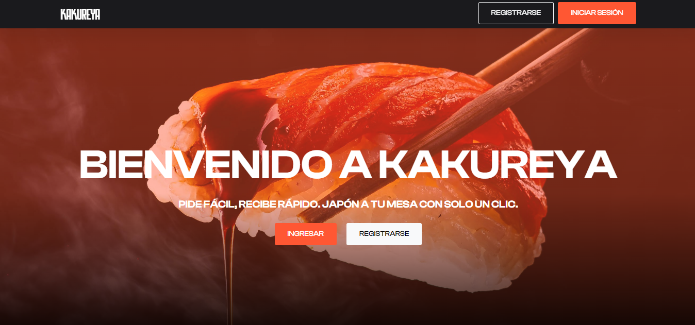
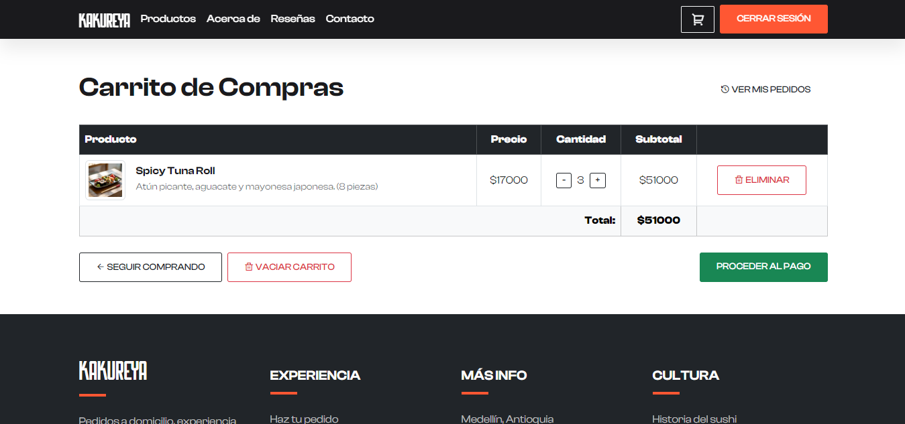
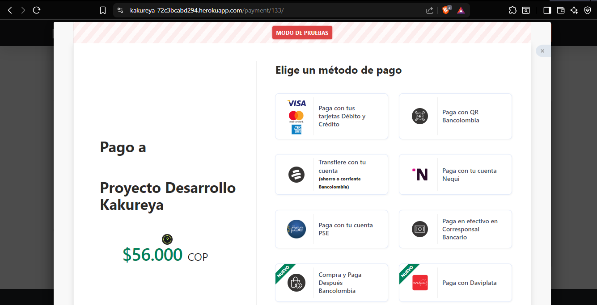
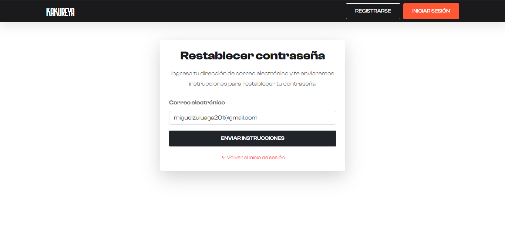

# Kakureya

[English](README.md) · **Español**

**Kakureya** es una aplicación web construida con Django que gestiona pedidos y domicilios de comida japonesa para llevar. Está pensada para mejorar la experiencia del cliente y agilizar la operación de restaurantes digitales, incluidas las dark kitchens, mediante un sistema eficiente.

<div align="center">



<br><br>



<br><br>



<br><br>



<br><br>

<h3>🏆 Certificado mejor proyecto PPI T&T, categoría tercer semestre, 2025-1</h3>


</div>

---

## Funcionalidades principales

| Módulo/Componente          | Funcionalidad                                                                |
|----------------------------|------------------------------------------------------------------------------|
| `usuarios/`                | Registro de usuarios, inicio de sesión, recuperación de contraseña, autenticación basada en sesiones |
| `productos/`               | Gestión de productos: creación, edición, eliminación                         |
| `menu/`                    | Visualización dinámica del menú organizado por categoría                     |
| `pedidos/`                 | Carrito de compras, confirmación de pedidos, historial de pedidos por usuario, seguimiento del estado del pedido |
| `pasarela/`                | Integración con la API de Wompi para pagos en línea                          |
| `templates/` y `static/`   | Interfaz responsive con archivos HTML, CSS y JS organizados                  |
| `settings.py`              | Configuración separada para los entornos local y de producción               |
| `.env` (no incluido)       | Variables sensibles: conexión a PostgreSQL, claves de AWS, correo, Wompi     |

---

## Tecnologías utilizadas

- Lenguaje del backend: Python 3.10+
- Framework web: Django 4.x
- Base de datos: PostgreSQL (entorno de producción), SQLite (modo de pruebas local)
- Frontend: HTML5, CSS3, Bootstrap 5, JavaScript
- Manejo de sesiones: Django Auth con recuperación de contraseña por correo electrónico
- Almacenamiento de archivos: AWS S3 para archivos multimedia estáticos
- Pasarela de pagos: Wompi (API pública y privada)
- Control de versiones: Git

---

## Instalación y configuración local

Este proyecto incluye un script de instalación automatizada (`setup.bat`) para entornos Windows.

### 1. Clonar el repositorio

```bash
git clone https://github.com/miguelczz/Kakureya.git
cd Kakureya
```
